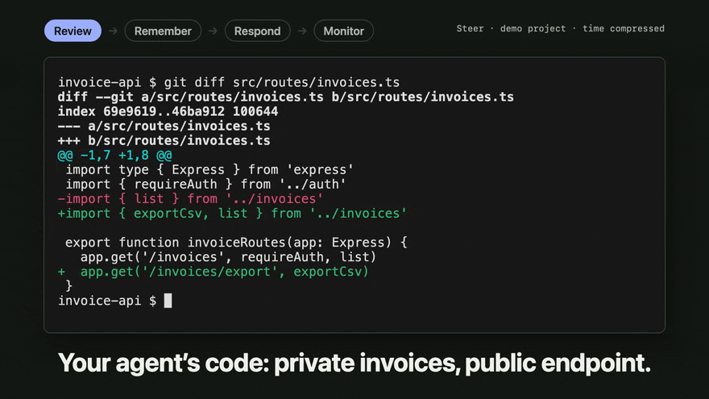

# Steer



Steer is an agentic feedback loop. Independent reviewers check your agent's code before it commits. Over time, Steer finds the problems that reoccur and proposes fixes to prevent them: repository checks, guards, and instructions.

Steer supports Claude Code and Codex on macOS and Linux.

## Install

For Claude Code:

```bash
claude plugin marketplace add steer-sh/steer
claude plugin install steer@steer-marketplace
```

For Codex:

```bash
codex plugin marketplace add steer-sh/steer
codex plugin add steer@steer-marketplace
```

The plugin carries the `steer` CLI, the `/steer`, `/steer-report` and `/steer-setup` skills, a custom statusline for Claude Code, and a session-start reminder when review work is pending.

Codex trusts no hook until you approve it in `/hooks`. Approve the plugin's reminder after you install it, the hooks that `/steer-setup` adds, and the first guard in each scope. Later guards need no new approval. If `/hooks` does not list a new hook, restart Codex.

## Setup

```text
/steer-setup
```

The skill asks which reviewer CLI and model to use, suggesting from the ones installed on your machine. It then arms the commit gate for your agent in every repository and places `steer` at `~/.steer/bin/steer`. Add that directory to your `PATH` to run `steer` from your own shell.

Reviews run through an installed, authenticated CLI: `claude`, `codex`, or `agy` (Google Antigravity). The reviewer can be different from the agent that writes your code. By default, three reviewers run in parallel. CLI reviews take time and use your reviewer's account or API allowance. If latency is too high, it's recommended to use a smaller model or use less reasoning effort.

Due to the current state of `agy`, it's not possible to block tool usage with command-line flags, nor is it possible to have ephemeral runs that do not create conversation history. With `agy`, your own `agy` permission rules stored in CLI configuration are the reviewer's only boundary, and each review stays in your `agy` conversation history.

Each review sends the commit message, the diff, and the unchanged files that refer to the changed code to your reviewer's provider. The reviewer can also read other files in the repository with its own tools. Do not commit a secret you would not send to that provider.

If you use both Codex and Claude Code, run `/steer-setup` in both CLI agents. It registers the new agent and keeps your reviewer configuration.

## Usage

### Commit as usual

Ask your agent to make a code change and commit normally. The reviewers raise concerns as findings. Your agent checks each finding against the code, fixes what holds up, and reports what it accepted and what it rejected. Steer will continue reviewing the commits until no accepted findings remain, or until 4 reviews in a row have blocked the commit.

The gate skips a commit when every changed file is prose (`.md`, `.txt` and similar) or when the diff is very small. `CLAUDE.md` and `AGENTS.md` are exceptions to the prose rule.

### Run `/steer-report`

The commit gate records every review and every decision locally under `~/.steer/state`. After some commits, run `/steer-report` in your agent. It reads those records and your agent's session history for recurring review findings, corrections and failed commands.

For each recurring problem, the report proposes a repository check, a guard, an instruction, or no change. Record a suggestion you decline too: Steer watches whether that problem grows afterwards.

A repository check runs `./check.sh` at the end of each agent turn, once you adopt the repository.

Steer measures each fix you accept from the report against how often its problem happened before. Later reports also audit each fix: they read a sample of the blocks it made and check whether they were correct.

To see what is active and what needs attention:

```bash
steer dashboard
steer status        # whether commits here are reviewed, and what stands in the way
```

## Add a rule yourself

The `/steer` skill routes a rule to the fix that can enforce it: a repository check, a guard, or an instruction. A concrete pattern becomes a Python guard, which the skill tests and installs. For example:

```text
/steer never use bare python in shell commands | use python3 instead
```

Guards check tool calls before they run and tell the agent how to correct a violation. They enforce concrete patterns and command forms; broader design decisions still need review. Python 3 is required to run guards.

You can also use bundled presets or verify staged files:

```bash
steer preset list
steer preset enable sql-injection-prevention
steer verify --staged
```

Guard commands default to project scope and register with every installed supported harness. Use `--scope global` or `--harness codex` to choose explicitly.

To remove a custom guard, run `steer remove <hook-name>`. For a factory preset, run `steer preset disable <preset>` yourself in a terminal; factory self-protection prevents an agent from disabling its own safeguards.

## Other setups

- **One repository only:** run `steer commit-gate install --harness <claude-code|codex> --scope project` in that repository instead of the global gate that setup installs.
- **Git pre-commit:** for other workflows, run `steer commit-gate install --precommit` in the repository. Choose one channel per repository to avoid reviewing commits twice.

## Development and reference

Run the standard checks from the repository root:

```bash
./check.sh
```

This checks Go formatting, builds the CLI, runs vet, and runs the tests. `./check-full.sh` also runs the slower model-backed skill-generation tests.

- [Project reference](CLAUDE.md): architecture, storage, configuration, builds, and test setup.
- [Guard skill](skills/steer/SKILL.md): rule generation and installation workflow.
- [Report skill](skills/steer-report/SKILL.md): evidence review and the fix workflow.
- `steer <command> --help`: command options, including team policy and verification.
