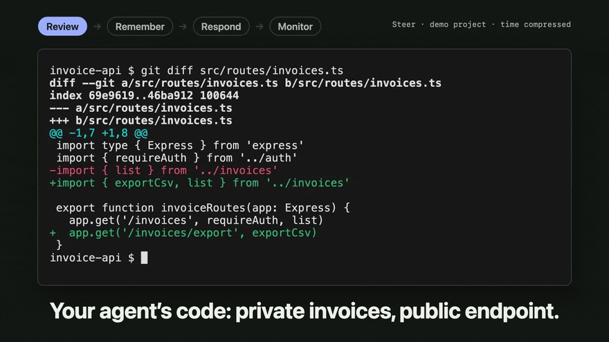

# Steer



Steer is an agentic feedback loop. Independent reviewers check your agent's code before it commits. Over time, Steer finds the problems that reoccur and proposes fixes to prevent them. These fixes are audited for efficacy, and can evolve over time if your needs change.

Steer currently supports Claude Code and Codex on macOS and Linux. It should work ok in WSL but that isn't a tested platform.

Website: [steer.sh](https://steer.sh)

## Install

For Claude Code:

```bash
claude plugin marketplace add steer-sh/steer
claude plugin install steer@steer-marketplace
```

For Codex:

```bash
codex plugin marketplace add steer-sh/steer
codex plugin add steer@steer-marketplace
```

The plugin consists of several components:
* `steer` CLI executable
* `/steer`, `/steer-report` and `/steer-setup` skills
* Custom status line for Claude Code (not currently possible in Codex)
* A session-start reminder hook when you should run `/steer-report`

The Codex hook trust model is different from Claude Code. It requires you to approve new hooks. Approve the hooks during initial install, and the first new guard in each scope. Later guards shouldn't require new approval. Note you may need to restart Codex if you don't get the hook approval prompt.

## Setup

```text
/steer-setup
```

After the installation step above, please run the `/steer-setup` skill. It helps you set up initial configuration such as which reviewer model to use. It then arms the commit gate for your agent in every repository and places `steer` at `~/.steer/bin/steer`. Optionally, you can add that directory to your `PATH` to run `steer` from your own shell.

Reviews can run through 3 different CLIs: `claude`, `codex`, or `agy` (Google Antigravity). They can also be run through any OpenAI-compatible chat-completions endpoint, such as OpenRouter, with an API key that you store with `steer reviewer key set` in your own terminal. The reviewer can be different from the agent that writes your code. Actually, in early testing this is a preferable setup (OpenAI reviewing Anthropic models, for example). By default, three reviewers run in parallel. Keep in mind that reviews do take time and they will use your CLI usage quota or API credits. If latency is too high, it's recommended to use a smaller model or use less reasoning effort. Good results are definitely possible using smaller models with low reasoning.

What reviewer model should you choose? As of November 2026, two good options with a mix of low-cost, speed and intelligence are *Sonnet 5.5 Low*, or *GPT-6.1-Terra Low*.

Due to the current state of `agy`, it's not possible to block tool usage with command-line flags, nor is it possible to have ephemeral runs that do not create conversation history. With `agy`, your own `agy` permission rules stored in CLI configuration are the reviewer's only boundary, and each review stays in your `agy` conversation history.

Each review transmits the commit message, the diff, and unchanged files that refer to the changed code to the reviewer. The reviewer can also read other files in the repository with its own tools. Keep this in mind when it comes to storing secrets or anything else private in your repository.

If you use both Codex and Claude Code, run `/steer-setup` in both CLI agents. It registers the new agent and keeps your reviewer configuration.

## Usage

### Commit as usual

Nothing changes when committing repo changes. Once your agent makes a commit, it will be automatically reviewed and concerns raised on findings. Your CLI agent will check each finding against the code, fix what holds up, and send back a report on what it accepted and what it rejected. Steer will continue reviewing the commits until no accepted - non-nitpick - findings remain, or until 4 reviews in a row have blocked the commit. 4 reviews were chosen as diminishing returns were found after this number.

Commits where every changed file is prose (`.md`, `.txt` and similar), or binary are skipped. `CLAUDE.md` and `AGENTS.md` are exceptions to the prose rule.

### Run `/steer-report`

Steer reviews and decisions are stored locally under `~/.steer/state`. Run `/steer-report` in your CLI agent to read that data, as well as your session history. This triggers a conversation with your agent to check review findings, corrections and failed commands.

For each recurring problem, `/steer-report` proposes a repository check, a guard, an instruction, or no change. It will also record if you decline a fix and will highlight if the problem grows afterwards.

* A repository check runs `./check.sh` at the end of each agent turn, once you adopt the repository.
* Guards check tool calls before they run and tell the agent how to correct a violation. Guards are written in Python so they are easy for a human to inspect. This also means Python3 in your environment is required for them to run.
* An instruction is a prompt-level fix. Some fixes cannot be deterministic, so instruction is a fallback method.

Steer measures the frequency of the problems you fix using before/after stats. Later reports will also audit each fix by examining each instance of blocks - were they legitimate blocks or in error? If they were in error, Steer will suggest modifications so the fix is as effective as possible.

To see what is active and what needs attention:

```bash
steer dashboard
steer status        # whether your Steer installation is healthy, and steps to take if it is not
```

## Add a rule yourself

The `/steer` skill creates a new rule using the most appropriate fix type: a repo check, a guard, or an instruction. For example:

```text
/steer never use bare python in shell commands | use python3 instead
```

Guard commands default to project scope and register with both Claude Code/Codex. Use `--scope global` or `--harness codex` to change scope or target CLI as needed.

To remove a custom guard - you can ask your agent to do so, or run `steer remove <hook-name>`.

Steer ships with self-protection on by default. It blocks your agent from changing Steer files, turning Steer hooks off, or removing Steer configuration entries. Other edits to your config that do not modify the Steer's entries are allowed to pass. It is intended to stop careless agent changes, not necessarily adversarial agents. `~/.steer/bin/steer config set protection.self off` turns off self-protection. You need to run this - agents cannot.

## Other setups

- **One repository only:** run `steer commit-gate install --harness <claude-code|codex> --scope project` in that repository instead of the global gate that setup installs.
- **Git pre-commit:** for other workflows (such as CLI agents other than the supported Claude Code and Codex), run `steer commit-gate install --precommit` in the repository. There is no need to use this option *in addition* to the standard hook-based commit-gate. That would result in commits being reviewed twice.

## Update

Claude Code and Codex can auto-update plugins periodically depending on your settings. To manually update instead, follow these steps:

For Claude Code:

```bash
claude plugin marketplace update steer-marketplace
claude plugin update steer@steer-marketplace
```

For Codex:

```bash
codex plugin marketplace upgrade steer-marketplace
```

`steer --version` names the build you run, with its commit and build date.

If either a manual or automatic update fails to update the binary properly, you can run `scripts/steer bin install`.

## Uninstall

Uninstall Steer as you would any other plugin from within Claude Code/Codex interfaces or using these commands:

```bash
claude plugin uninstall steer@steer-marketplace
codex plugin remove steer@steer-marketplace
```
However, to uninstall the hooks that Steer requires to function - please additionally run:

```bash
~/.steer/bin/steer uninstall          # dry-run view of what it will remove
~/.steer/bin/steer uninstall --apply
```

If you want to uninstall on only one CLI you can also do that with `~/.steer/bin/steer uninstall --harness <claude-code|codex>`.

Your local data in `~/.steer` including ledgers, guards and settings is not removed in case you reinstall. You can add `--purge` to the above command if you want it fully removed.

## Development and reference

Build the CLI from the cli subfolder using `./build.sh`, then run the standard checks from the repository root against that build:

```bash
STEER_BIN="$PWD/scripts/steer" ./check.sh
```

This checks Go formatting, builds the CLI, runs vet, and runs the tests. `./check-full.sh` also runs the slower model-backed skill-generation tests. NOTE - These will require you to be logged-in and auth'd on Claude Code and Codex, and they will use significant quota or API credits.

- [Contributing](CONTRIBUTING.md): how to contribute
- [Architecture](ARCHITECTURE.md): detailed architecture design and invariants.
- [Project map](CLAUDE.md): intended as a roadmap for your agent to navigate the repo.
- [Guard skill](skills/steer/SKILL.md): core rule generation and installation workflow.
- [Report skill](skills/steer-report/SKILL.md): evidence review, audit and the fix workflow.
- `steer <command> --help`: CLI command options
