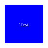

# Documentation with Mixed Image Links

This markdown file has a mix of valid and invalid image references.

## Section 1: Valid Images

Here's our company logo (this exists):

A valid screenshot:

## Section 2: Broken Images

This one doesn't exist:

Neither does this one:

## Section 3: More Valid Images  

A valid diagram:

## Section 4: More Broken Images

This path is wrong:

So is this one:

## Section 5: Mix of Everything

Valid reference:

Invalid reference right after:

Another valid one:

And another invalid one:

## Conclusion

This file has both valid and invalid image references, so it should be blocked due to the invalid ones.